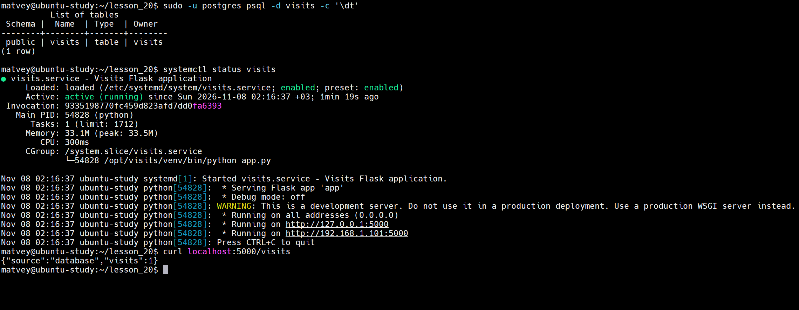
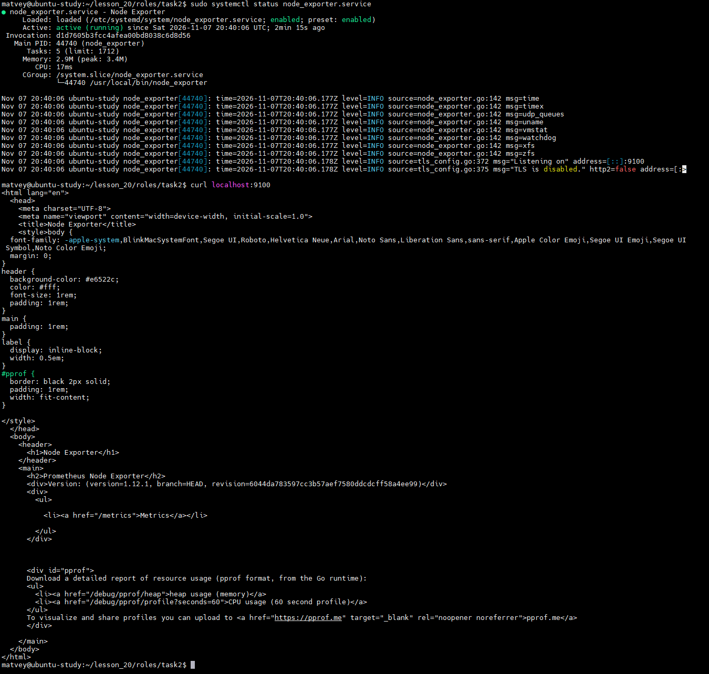
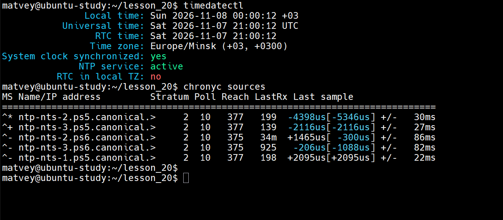
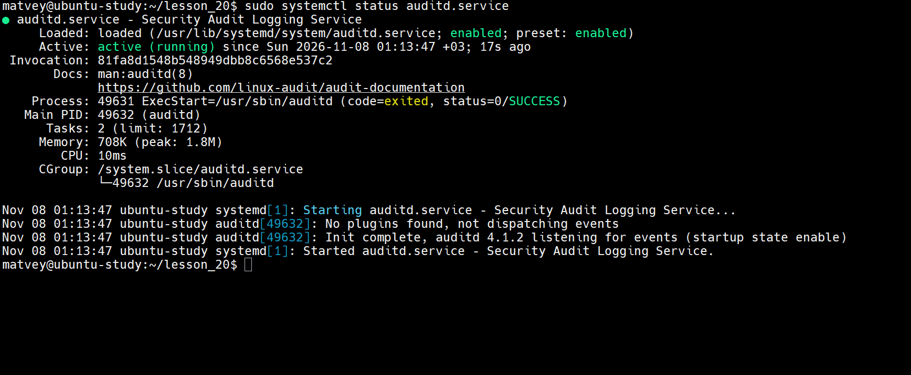

1) Написать роль (роли?) для развертывания приложения https://gitlab.com/devops201206/visits НЕ в docker

Tasks:
 ```
- name: install Postgresql
  ansible.builtin.apt:
    name:
      - postgresql
      - python3-psycopg2
      - acl
    state: latest
    update_cache: true


- name: start postgresql
  ansible.builtin.service:
    name: postgresql
    enabled: true
    state: started


- name: create db user
  become_user: postgres
  community.postgresql.postgresql_user:
    name: "{{ visits_db_user }}"
    password: "{{ visits_db_password }}"


- name: create database
  become_user: postgres
  community.postgresql.postgresql_db:
    name: "{{ visits_db_name }}"
    owner: "{{ visits_db_user }}"


- name: create table visits
  become_user: postgres
  community.postgresql.postgresql_query:
    db: "{{ visits_db_name }}"
    query: "CREATE TABLE IF NOT EXISTS visits (id SERIAL PRIMARY KEY);"
- name: give table to app user
  become_user: postgres
  community.postgresql.postgresql_owner:
    db: "{{ visits_db_name }}"
    new_owner: "{{ visits_db_user }}"
    obj_name: visits
    obj_type: table


- name: give table to app user
  become_user: postgres
  community.postgresql.postgresql_owner:
    db: "{{ visits_db_name }}"
    new_owner: "{{ visits_db_user }}"
    obj_name: visits
    obj_type: table


- name: install redis
  ansible.builtin.apt:
    name: redis-server
    state: latest
    update_cache: true


- name: start redis
  ansible.builtin.service:
    name: redis-server
    enabled: true
    state: started


- name: install packages
  ansible.builtin.apt:
    name:
      - git
      - python3-venv
      - python3-pip
      - python3-dev
      - libpq-dev
      - gcc
    state: latest
    update_cache: true


- name: create group
  ansible.builtin.group:
    name: "{{ visits_group }}"
    system: true


- name: create user
  ansible.builtin.user:
    name: "{{ visits_user }}"
    group: "{{ visits_group }}"
    system: true
    shell: /usr/sbin/nologin
    create_home: false


- name: clone application
  ansible.builtin.git:
    repo: "{{ visits_repo_url }}"
    dest: "{{ visits_dir }}"
  notify: Restart visits


- name: set owner of app directory
  ansible.builtin.file:
    path: "{{ visits_dir }}"
    state: directory
    owner: "{{ visits_user }}"
    group: "{{ visits_group }}"
    recurse: true


- name: install python dependencies
  ansible.builtin.pip:
    name:
      - flask
      - psycopg2
      - redis
    virtualenv: "{{ visits_venv }}"
    virtualenv_command: python3 -m venv
  notify: Restart visits

- name: install env file
  ansible.builtin.template:
    src: visits.env.j2
    dest: /etc/visits.env
    owner: root
    group: "{{ visits_group }}"
    mode: "0640"
  notify: Restart visits

- name: install systemd unit
  ansible.builtin.template:
    src: visits.service.j2
    dest: /etc/systemd/system/visits.service
    owner: root
    group: root
    mode: "0644"
  notify:
    - Reload systemd
    - Restart visits

- name: start visits
  ansible.builtin.systemd:
    name: visits
    enabled: true
    state: started
    daemon_reload: true
```

Defaults:
 ```
visits_repo_url: "https://gitlab.com/devops201206/visits.git"

visits_user: visits
visits_group: visits
visits_dir: /opt/visits
visits_venv: /opt/visits/venv

visits_db_host: 127.0.0.1
visits_redis_host: 127.0.0.1
```

Handlers:
 ```
 - name: Reload systemd
  ansible.builtin.systemd:
    daemon_reload: true

- name: Restart visits
  ansible.builtin.service:
    name: visits
    state: restarted

```

Templates visit.env.j2:
 ```
 POSTGRES_DB={{ visits_db_name }}
POSTGRES_USER={{ visits_db_user }}
POSTGRES_PASSWORD={{ visits_db_password }}
POSTGRES_HOST={{ visits_db_host }}
REDIS_HOST={{ visits_redis_host }}

```

Templates visit.service.j2:
 ```
 [Unit]
Description=Visits Flask application
After=network-online.target postgresql.service redis-server.service

[Service]
Type=simple
User={{ visits_user }}
Group={{ visits_group }}
WorkingDirectory={{ visits_dir }}
EnvironmentFile=/etc/visits.env
ExecStart={{ visits_venv }}/bin/python app.py
Restart=always

[Install]
WantedBy=multi-user.target

```


2) Написать роль для установки node-exporter НЕ в docker

  Tasks:
 ```
 - name: download node_exporter
  ansible.builtin.get_url:
    url: "{{ node_exporter_download_url }}"
    dest: "{{ node_exporter_tmp_dir }}/node_exporter-{{ node_exporter_version }}.tar.gz"
    mode: "0644"

- name: unarchive node_explorter
  ansible.builtin.unarchive:
    src: "{{ node_exporter_tmp_dir }}/node_exporter-{{ node_exporter_version }}.tar.gz"
    dest: "{{ node_exporter_tmp_dir }}"
    remote_src: true

- name: install node_exporter
  ansible.builtin.copy:
    src: "{{ node_exporter_tmp_dir }}/node_exporter-{{ node_exporter_version }}/node_exporter"
    dest: "{{ node_exporter_bin_dir }}/node_exporter"
    remote_src:  true
    mode: "0755"
  notify: Restart node_exporter


- name: install systemd unit
  ansible.builtin.template:
    src: node_exporter.service.j2
    dest: /etc/systemd/system/node_exporter.service
    owner: root
    group: root
    mode: "0644"
  notify:
    - Reload systemd
    - Restart node_exporter

- name: start node_exporter
  ansible.builtin.systemd:
    name: node_exporter
    enabled: true
    state: started
    daemon_reload: true

```

Defaults:
```
node_exporter_bin_dir: /usr/local/bin
node_exporter_port: "0.0.0.0:9100"
node_exporter_download_url: "https://github.com/prometheus/node_exporter/releases/download/v1.12.1/node_exporter-1.12.1.linux-amd64.tar.gz"
node_exporter_version: "1.12.1.linux-amd64"
node_exporter_tmp_dir: /tmp
```

Handlers:
```
- name: Reload systemd
  ansible.builtin.systemd:
    daemon_reload: true

- name: Restart node_exporter
  ansible.builtin.systemd:
    name: node_exporter
    state: restarted
```

Templates node_exporter.service.j2:
```
[Unit]
Description=Node Exporter
After=network-online.target

[Service]
Type=app
User=root
Group=root
ExecStart={{ node_exporter_bin_dir }}/node_exporter

Restart=always
RestartSec=5


[Install]
WantedBy=multi-user.target
```


3) Написать роль для настройки времени и часового пояса с помощью chrony или ntpd

Tasks:
```
- name: know timezone
  ansible.builtin.command: timedatectl show --property=Timezone --value
  register: current_tz
  changed_when: false

- name: changed timezone
  ansible.builtin.command: timedatectl set-timezone Europe/Minsk
  when: current_tz.stdout != "Europe/Minsk"

- name: install chrony
  ansible.builtin.package:
    name: chrony
    state: present

- name: ON chrony
  ansible.builtin.service:
    name: chrony
    enabled: true
    state: started
```



4) настройку основного конфигурационного файла /etc/audit/auditd.conf через шаблон Jinja2

   <br>- log_file</br>
    <br>- max_log_file</br>
    <br>- num_logs</br>
    <br>- space_left_action</br>
    <br>- admin_space_left</br>

управление правилами аудита: размещение правил в /etc/audit/rules.d/security.rules с помощью шаблона и переменных

```
auditd_rules:
  - "-a always,exit -F arch=b64 -S open,openat -F success=1"
  - "-w /etc/passwd -p wa -k identity"
  - "-w /etc/sudoers -p wa -k scope"
```

Tasks:
```
- name: install auditd
  ansible.builtin.package:
      name: auditd
      state: present


- name: setting auditd
  ansible.builtin.template:
    src: auditd.conf.j2
    dest: "{{ auditd_dir }}/auditd.conf"
    owner: root
    group: root
    mode: "0644"
    backup: true
  notify: Restart auditd


- name: rules auditd
  ansible.builtin.template:
    src: security.rules.j2
    dest: "{{ auditd_dir }}/rules.d/security.rules"
    owner: root
    group: root
    mode: "0644"
  notify: Load audit rules


- name: start auditd
  ansible.builtin.service:
    name: auditd
    enabled: true
    state: started
```

Defaults:
```
auditd_dir: /etc/audit

auditd_log_file: /var/log/audit/audit.log
auditd_max_log_file: 8
auditd_num_logs: 5
auditd_space_left: 75
auditd_space_left_action: SYSLOG
auditd_admin_space_left: 50

audit_rules:
  - "-a always,exit -F arch=b64 -S open,openat -F success=1"
  - "-w /etc/passwd -p wa -k identity"
  - "-w /etc/sudoers -p wa -k scope"
```

Handlers:
```
- name: Restart auditd
  ansible.builtin.service:
    name: auditd
    state: restarted

- name: Load audit rules
  ansible.builtin.command: augenrules --load
```

Templates auditd.conf.j2
```
log_file = {{ auditd_log_file }}
max_log_file = {{ auditd_max_log_file }}
num_logs = {{ auditd_num_logs }}
space_left_action = {{ auditd_space_left_action }}
admin_space_left = {{ auditd_admin_space_left }}
space_left = {{ auditd_space_left }}
```




